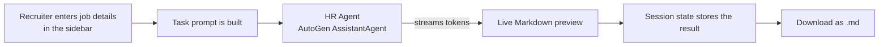

# HR Agent: Job Description Generator

**An AI recruiter that writes clear, inclusive and well-structured job descriptions in seconds, built with [AutoGen AgentChat](https://github.com/microsoft/autogen) and [Streamlit](https://streamlit.io).**


Enter a job role, company, location, experience level and key skills. The HR agent streams a complete job description in Markdown, token by token, and you can download it with one click.


---

## Table of Contents

- [Overview](#overview)
- [Features](#features)
- [How It Works](#how-it-works)
- [Tech Stack](#tech-stack)
- [Getting Started](#getting-started)
- [Usage](#usage)
- [Configuration](#configuration)
- [Job Description Format](#job-description-format)
- [Project Structure](#project-structure)
- [Customization](#customization)
- [Troubleshooting](#troubleshooting)
- [Known Limitations](#known-limitations)
- [Roadmap](#roadmap)
- [Contributing](#contributing)
- [License](#license)

---

## Overview

Writing job descriptions is slow and repetitive, and it is easy to get wrong. Descriptions often end up too long, inconsistent between roles, or full of biased wording that puts good candidates off.

This app gives recruiters and hiring managers an AI assistant that acts like an experienced tech recruiter. It produces a consistent eight-section job description that suits the requested experience level and avoids biased language.

| | |
|---|---|
| **Problem** | Writing job descriptions by hand takes time, and the results are inconsistent and sometimes biased |
| **Solution** | An AutoGen HR agent with a fixed structure and clear writing rules |
| **Output** | A ready-to-publish Markdown job description, streamed live and downloadable as `.md` |
| **Stack** | Python, AutoGen AgentChat, OpenAI, Streamlit |

## Features

- **Live streaming:** the job description appears token by token as the model writes it, so you never stare at a blank screen
- **Consistent structure:** every job description follows the same eight sections
- **Inclusive by design:** the agent is told to avoid biased language and keep requirements realistic for the experience level
- **Simple inputs:** job role, company, location, experience, employment type and key skills, with sensible defaults
- **One-click download:** save the job description as a Markdown file named after the role, for example `junior_python_developer_jd.md`
- **Keeps your result:** the generated job description stays on screen when the page reruns, so the download button never loses it
- **Clean, modern UI:** gradient styling, soft 3D cards and hover effects, written in a small block of custom CSS
- **Configurable model:** switch the OpenAI model with one environment variable

## How It Works



1. The sidebar collects the job details.
2. `build_task()` turns them into a structured task prompt.
3. `build_hr_agent()` creates an AutoGen `AssistantAgent` with a recruiter system message and streaming turned on.
4. `stream_jd()` reads `ModelClientStreamingChunkEvent` events from `agent.run_stream()` and updates the page as each chunk arrives.
5. The finished job description is saved in `st.session_state`, so it stays visible and downloadable after the page reruns.

## Tech Stack

| Component | Purpose |
|---|---|
| [AutoGen AgentChat](https://microsoft.github.io/autogen/) | Agent framework (`AssistantAgent`, streaming events) |
| [autogen-ext](https://pypi.org/project/autogen-ext/) | OpenAI model client (`OpenAIChatCompletionClient`) |
| [OpenAI](https://platform.openai.com/) | Language model, `gpt-4o-mini` by default |
| [Streamlit](https://streamlit.io) | Web interface |
| [python-dotenv](https://pypi.org/project/python-dotenv/) | Loads API keys from `.env` |

## Getting Started

### Prerequisites

- Python 3.10 or later
- An [OpenAI API key](https://platform.openai.com/api-keys)

### 1. Clone the repository

```bash
git clone https://github.com/<your-username>/autogen-hr-jd-generator.git
cd autogen-hr-jd-generator
```

### 2. Create a virtual environment

```bash
python -m venv venv

# macOS / Linux
source venv/bin/activate

# Windows
venv\Scripts\activate
```

### 3. Install dependencies

```bash
pip install -r requirements.txt
```

`requirements.txt`:

```text
streamlit>=1.40
autogen-agentchat
autogen-ext[openai]
python-dotenv
```

### 4. Add your API key

Create a `.env` file next to `app.py`:

```env
OPENAI_API_KEY=sk-your-key-here
OPENAI_MODEL=gpt-4o-mini
```

### 5. Run the app

```bash
streamlit run app.py
```

The app opens in your browser at `http://localhost:8501`.

## Usage

1. Fill in the job details in the sidebar, or keep the defaults to try it out.
2. Click **Generate JD**.
3. Watch the job description stream into the card.
4. Click **Download JD (.md)** to save it.

**Example input:**

| Field | Value |
|---|---|
| Job role | Junior Python Developer |
| Company name | TechNova Solutions |
| Location | Chennai, India (Hybrid) |
| Experience | 0-1 years |
| Employment type | Full-time |
| Key skills | Python, OOP, Git, SQL, REST APIs, Flask/Django basics, unit testing |

**Example output (shortened):**

```markdown
# Junior Python Developer

## About the Company
TechNova Solutions is a growing technology company...

## Role Overview
We are looking for a motivated Junior Python Developer to join our hybrid team in Chennai...

## Key Responsibilities
- Write clean, well-tested Python code...
```

## Configuration

| Variable | Required | Default | Description |
|---|---|---|---|
| `OPENAI_API_KEY` | Yes | none | Your OpenAI API key |
| `OPENAI_MODEL` | No | `gpt-4o-mini` | Any OpenAI chat model, for example `gpt-4o` |

If `OPENAI_API_KEY` is missing, the app shows an error and stops before calling the model.

## Job Description Format

Every generated job description contains these sections, in this order:

1. Job Title
2. About the Company
3. Role Overview
4. Key Responsibilities
5. Required Skills & Qualifications
6. Nice-to-Have Skills
7. What We Offer
8. How to Apply

## Project Structure

```text
autogen-hr-jd-generator/
├── app.py              # Streamlit UI, HR agent and streaming logic
├── requirements.txt    # Python dependencies
├── .env                # Your API key (never commit this)
├── .gitignore
├── docs/
│   └── screenshot.png  # App screenshot for this README
└── README.md
```

Recommended `.gitignore`:

```gitignore
.env
venv/
__pycache__/
*.pyc
```

## Customization

All changes are made in `app.py`.

| To change | Edit |
|---|---|
| The agent's tone, rules or sections | `HR_SYSTEM_MESSAGE` |
| The input fields or their defaults | The `with st.sidebar:` block |
| The experience levels or employment types | The `st.selectbox` options |
| What is sent to the agent | `build_task()` |
| The colours and 3D styling | The `CSS_3D` block |
| The model | `OPENAI_MODEL` in `.env` |

## Troubleshooting

| Problem | Fix |
|---|---|
| `OPENAI_API_KEY is not set` | Make sure `.env` is in the same folder as `app.py` and the variable name is spelled exactly right |
| `AuthenticationError` | Check that your API key is valid and your OpenAI account has credit |
| `ModuleNotFoundError: autogen_agentchat` | Activate your virtual environment and run `pip install -r requirements.txt` again |
| Custom styling doesn't appear | Upgrade Streamlit to 1.40 or later. The CSS targets containers by `key` |
| A deprecation warning about `use_container_width` | It's harmless. In newer Streamlit versions, replace it with `width="stretch"` |
| The output is wrapped in a code block | Regenerate. The system message tells the model not to, but smaller models sometimes ignore it |

## Known Limitations

- **Review before publishing.** The agent is told to avoid biased wording, but it can still make mistakes. Have a person check every job description, including salary, benefits and legal requirements, before posting it.
- **One agent, one pass.** There is no separate reviewer agent checking the draft.
- **No memory between runs.** Each click creates a new agent, so it can't refine a previous job description from your feedback.
- **Markdown export only.** PDF and Word export are not built in yet.

## Roadmap

- [ ] A reviewer agent that scores each job description for clarity and inclusive language
- [ ] Follow-up edits such as "make it shorter" or "add remote benefits"
- [ ] Export to PDF and Word
- [ ] Saved company profiles so the company details fill in automatically
- [ ] Job descriptions in more languages, including Arabic
- [ ] Publishing straight to job boards

## Contributing

Contributions are welcome.

1. Fork the repository.
2. Create a feature branch: `git checkout -b feature/your-feature`
3. Commit your changes: `git commit -m "Add your feature"`
4. Push the branch: `git push origin feature/your-feature`
5. Open a pull request with a clear description of the change.

## License

Released under the [MIT License](LICENSE).

---

Built with [AutoGen](https://github.com/microsoft/autogen) and [Streamlit](https://streamlit.io).